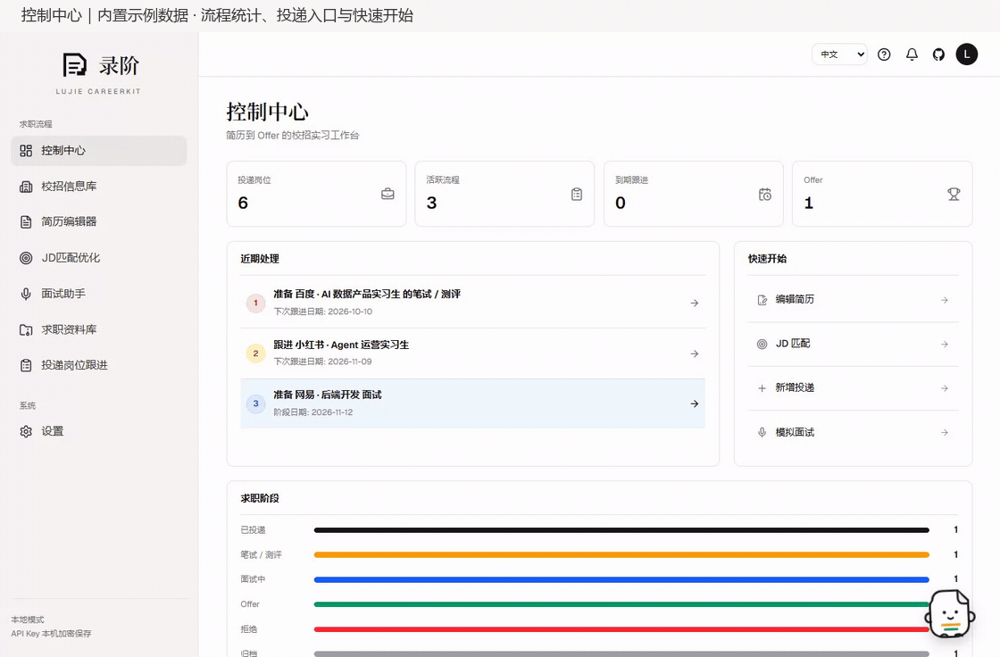
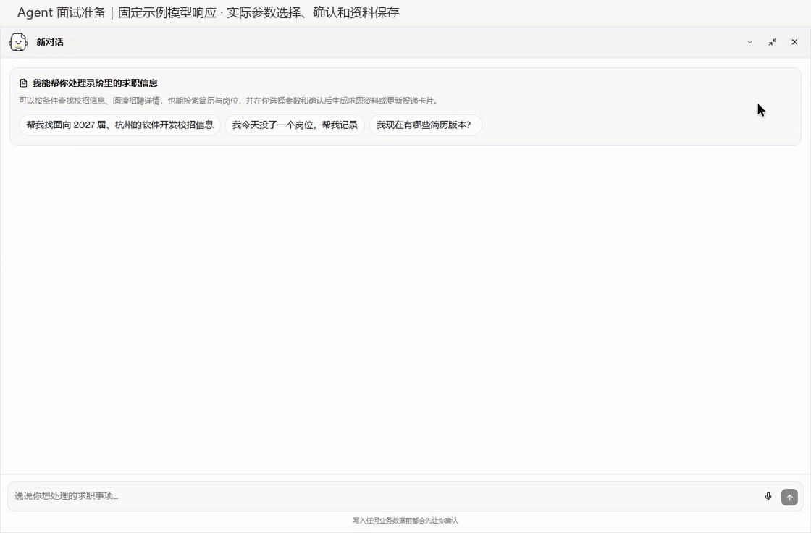
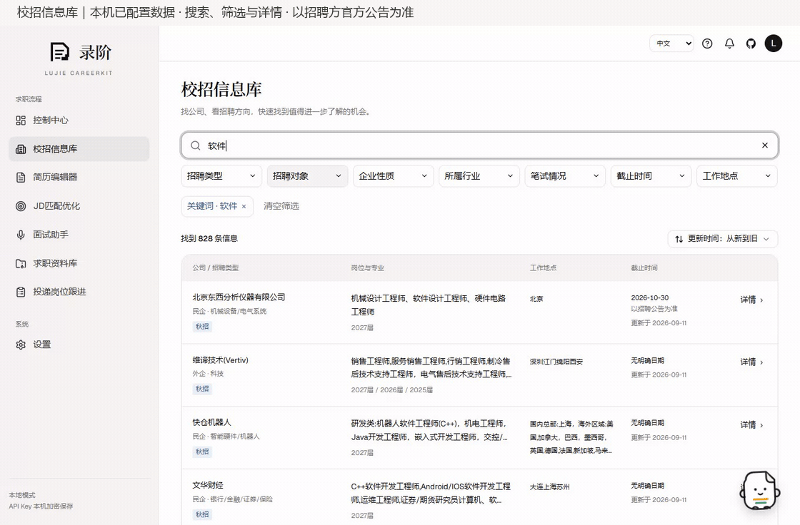
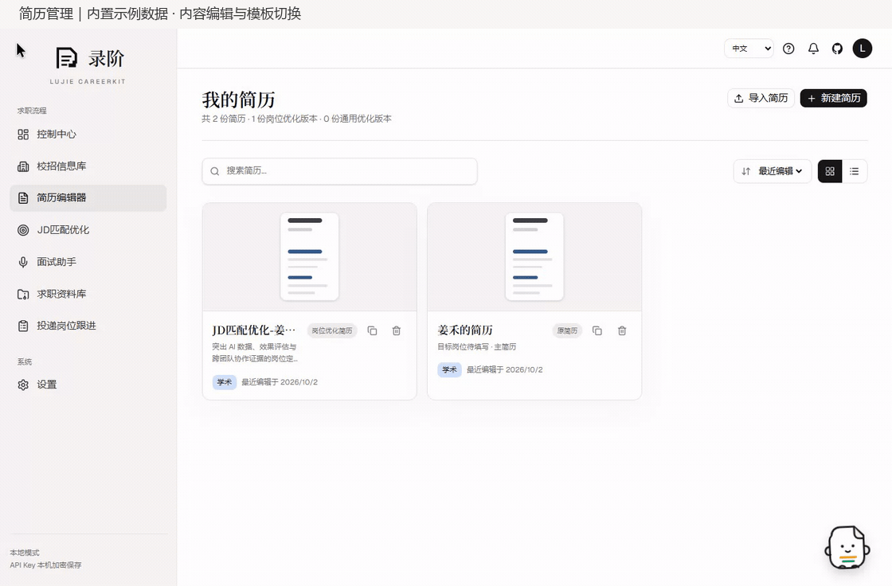
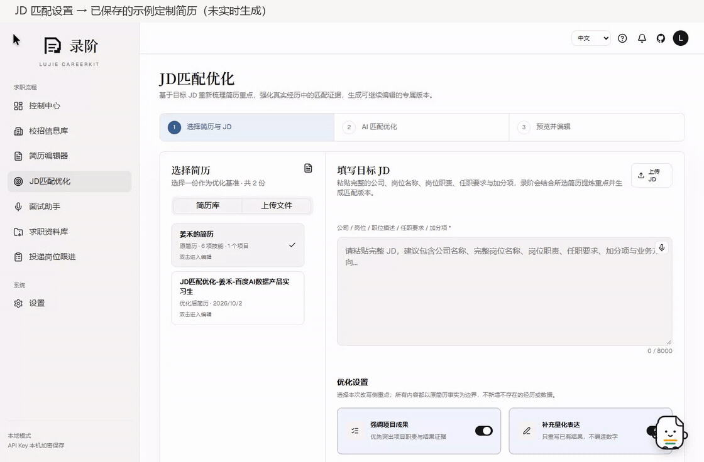
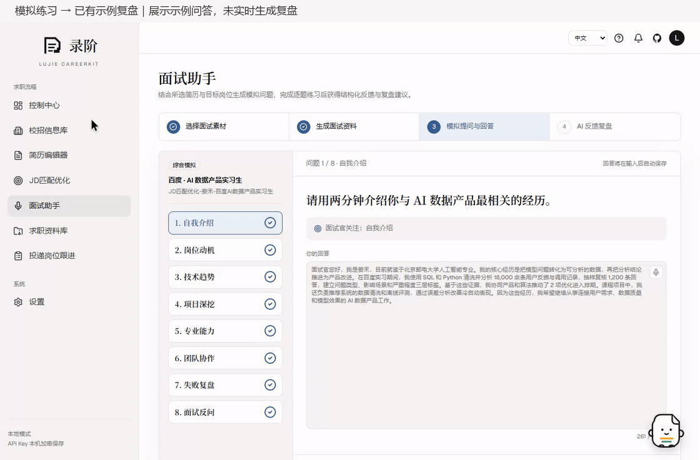
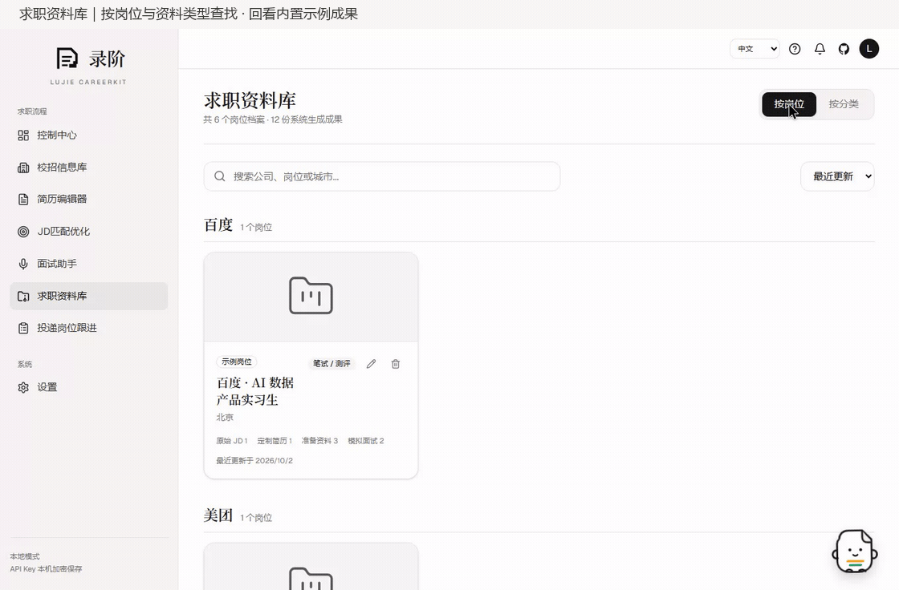
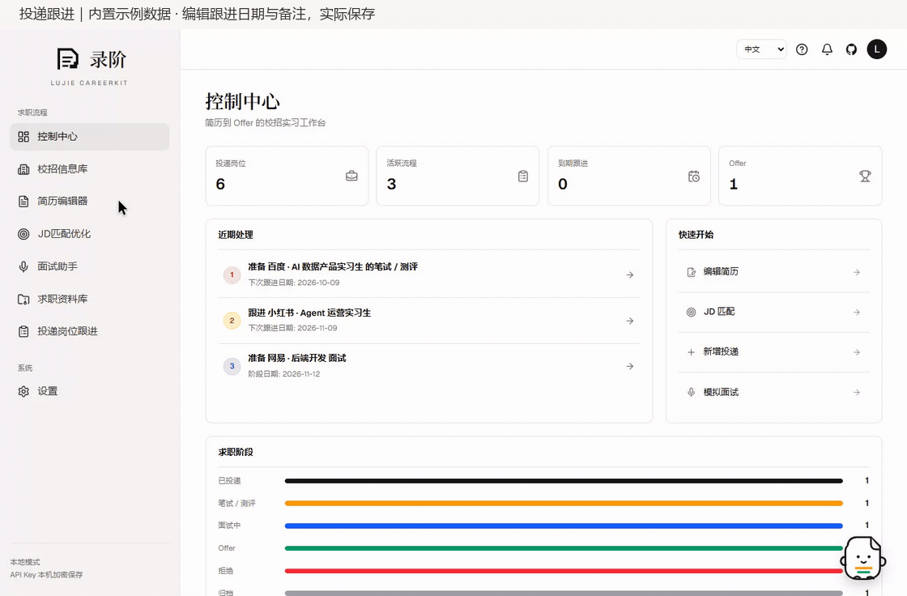

<p align="center">
  
</p>

<h1 align="center">LuJie CareerKit</h1>

<p align="center">
  <strong>A career Agent workspace from resume editing to offer acceptance, covering resume editing, JD matching, application tracking, mock interviews, reviews, and more.</strong>
</p>
<p align="center">
  English · <a href="README.md">简体中文</a>
</p>

<p align="center">
  
  
  
  
  
  
</p>

https://github.com/user-attachments/assets/d4c1a1bb-4461-4c03-99cd-44d9ac6e4dfc

## Overview

LuJie CareerKit is built for internships, campus recruiting, and career job searches. It brings resume editing, JD matching, career-material organization, interview preparation, mock practice, and application tracking into an Agent-driven workspace. You can maintain multiple resume versions for different roles, generate more relevant resumes and interview materials from a JD, and continuously organize every analysis, practice session, and application update.

## Online Preview

Try the live preview at [https://lujie.chozzc.dev](https://lujie.chozzc.dev). Personal data in the online preview stays in the current browser and does not automatically synchronize with local source or Docker installations.

## Feature Demos

<table width="100%">
  <tr>
    <th width="50%">Control Center</th>
    <th width="50%">LuJie Agent · Can invoke built-in career tools</th>
  </tr>
  <tr>
    <td width="50%" valign="top">
      
    </td>
    <td width="50%" valign="top">
      
    </td>
  </tr>
  <tr>
    <th width="50%">Campus Recruitment</th>
    <th width="50%">Resume Editor</th>
  </tr>
  <tr>
    <td width="50%" valign="top">
      
    </td>
    <td width="50%" valign="top">
      
    </td>
  </tr>
  <tr>
    <th width="50%">JD Matching</th>
    <th width="50%">Interview Assistant</th>
  </tr>
  <tr>
    <td width="50%" valign="top">
      
    </td>
    <td width="50%" valign="top">
      
    </td>
  </tr>
  <tr>
    <th width="50%">Career Materials</th>
    <th width="50%">Application Tracking</th>
  </tr>
  <tr>
    <td width="50%" valign="top">
      
    </td>
    <td width="50%" valign="top">
      
    </td>
  </tr>
</table>

## Highlights

- **Structured resume editing**: maintain multiple resume versions, create an independent copy of any resume to try different edits, edit education, internship, project, skill, and custom sections, switch templates and themes, and export PDF, PNG, or editable DOCX files.
- **AI resume analysis**: diagnose action-result structure, evidence, clarity, and organization first; let the user choose which issues and directions to address; then create an independent optimized version while preserving the original.
- **Cover letters and recruiter greetings**: combine the current resume, a complete JD, and user-provided availability details to generate a formal cover letter or a concise recruiter-chat opener, then edit, copy, or regenerate the result.
- **JD matching**: paste a complete JD with the company, full role title, requirements, and responsibilities, then let AI diagnose evidence, reorder emphasis, improve wording, and save a role-specific version without inventing experience.
- **Role-specific interview prep**: combine a selected resume with a complete JD to generate and save a guide with an overview, capability profile, evidence gaps, core knowledge, experience deep dives, targeted questions, and a preparation plan, then export the complete guide as an editable Word document or print-ready PDF.
- **Application tracking**: record companies, roles, sources, stages, deadlines, follow-up dates, notes, JD text, and linked resume versions.
- **Mock interviews and review**: generate interview questions from a resume and JD, save answer drafts, and create an AI review report you can revisit.
- **Career materials library**: organize original JDs, tailored resumes, interview prep guides, mock answers, and AI reviews by role or material type, with per-artifact viewing, editing, and deletion.
- **Campus recruitment library**: filter recruitment records by keywords, recruitment type, graduation cohort, location, and more; view positions or eligible majors, deadline information, and recruitment links.
- **In-app agent**: search campus opportunities, saved jobs and privacy-filtered resumes, open specific recruitment details, then select parameters and confirm creating independent resumes, JD-tailored versions, interview guides, mock interviews, resume-template changes, or application-card updates.
- **Job-search Agent Skills**: reuse LuJie's refined workflows for resume improvement, interview preparation, mock interviews, and job application writing in coding agents such as Codex and Claude Code.
- **Data and privacy controls**: resumes, jobs, applications, generated materials, agent conversations, and settings are stored in a local SQLite database for long-term personal use.

## In-App Agent

Click the assistant in the bottom-right corner to open the agent. Drag it to reposition it, expand the conversation, create a thread, or revisit history. It reuses the model and API key configured in Settings; configure AI and test the connection before use. Conversations are stored locally in SQLite.

The workflow is **describe the task → resolve the target → select parameters when needed → review and approve the write → open the result**. Searches do not require approval. Creating or updating business data shows an approval card with the exact target and action, which you can confirm or cancel. JD tailoring first collects optimization preferences; interview preparation and simulation first collect the mode, then still require write approval.

For example:

| Goal | Example request |
| --- | --- |
| Discover opportunities | Find software-related campus recruitment in Hangzhou for the 2027 graduation cohort, and open one record's details. |
| Schedule a follow-up | Find my Baidu application, set the next follow-up to 2026-10-09, and append “Send a follow-up email.” |
| Create a resume | Create an independent backend engineering resume from these real experiences: … |
| Tailor a version | Use my backend resume with this complete JD and create a new tailored version: … |
| Prepare for interviews | Generate project-focused interview preparation for my Baidu role and its tailored resume. |
| Start practice | Create a comprehensive mock interview using the same role and resume. |
| Change appearance | Find my base resume and switch it to the classic template. |

Referenced roles and resumes must exist in your library. Clarify ambiguous targets and supply a complete JD when needed. The current source can:

- filter campus recruitment records from natural-language requests, paginate results, read full records, and open their details from the conversation; records are not automatically added to personal jobs or application tracking, and an unknown deadline does not mean recruitment is still open;
- search existing jobs and application cards from natural-language requests;
- search resumes by name, role, skill, school, company, or project, then read one complete privacy-filtered version by ID;
- propose creating or updating an application card, then execute only after explicit confirmation;
- create a new independent resume from experience the user explicitly stated;
- create a new JD-tailored resume version without overwriting its source;
- generate interview-preparation material for an exact saved job and resume;
- select an interview mode, generate a mock interview, and open the interactive answering workspace;
- change a saved resume's template while preserving its facts and sections;
- provide contextual guidance about resumes, JDs, interviews, and job-search planning.

It does not overwrite existing resume content, delete business data, or operate external recruitment sites. Every business-data write requires confirmation.

Full conversation history stays on your machine. The model receives recent complete turns within a context budget, preserving pending tools and approvals. History summaries and cross-conversation memory are not implemented, so earlier conditions in long conversations may need to be restated. If required context is too large or saving history conflicts with another update, the agent shows an error; check any generated artifacts before continuing.

## Agent Skills

LuJie provides more than an application interface. Four of its refined job-search workflows are also packaged as Agent Skills for coding agents. Each skill includes a complete workflow, research requirements, factual boundaries, and quality checks rather than a single prompt.

| Skill                    | Purpose                                                                              |
| ------------------------ | ------------------------------------------------------------------------------------ |
| `resume-improvement`     | Diagnose and improve a resume, with optional JD-specific tailoring                   |
| `prepare-job-interview`  | Research a company and role, then build a structured interview preparation guide     |
| `mock-interview-coach`   | Run an interactive mock interview with adaptive follow-ups and evidence-based review |
| `job-application-writer` | Write cover letters, recruiter greetings, emails, referrals, and follow-up messages  |

After cloning the repository, launch Codex from the project directory and describe the task directly. Codex can select the relevant skill automatically, or you can explicitly name one such as `$resume-improvement`. Claude Code and other coding agents can also read the corresponding `SKILL.md` and follow the same workflow.

For example:

- `Use $resume-improvement to review this resume for a backend engineering role.`
- `Use $prepare-job-interview with my resume and this JD to build an interview preparation guide.`

For company- or role-specific tasks, the skills proactively research current information when search tools are available and the user has not disabled web access. They require sources, distinguish facts from inference, and prohibit inventing candidate experience, skills, or outcomes.

## Data and Privacy

- Resume content, resume versions, jobs, applications, interview prep guides, mock sessions, agent conversations, and settings are stored in `prisma/dev.db`.
- Docker stores personal data in its mounted volume. Local source runs, Docker and the online preview do not automatically synchronize personal data.
- API keys are configured from the in-app Settings page. They are encrypted before being saved to SQLite.
- `LUJIE_SETTINGS_SECRET` is the local encryption secret for saved AI keys. Use a long random value in `.env.local`.
- AI tasks send the required resume, JD, or conversation content to your configured model provider. Local storage does not make AI requests fully offline. Agent resume reads filter contact information such as email addresses and phone numbers.

## Quick Start

### Requirements

- Node.js 20.9 or later
- npm
- Chrome or Edge for the best browser speech experience

### Docker Deployment (Recommended)

```bash
docker run -d --name lujie-careerkit \
  -p 3000:3000 \
  -v lujie-data:/data \
  -e LUJIE_SETTINGS_SECRET="replace-with-a-long-random-string" \
  ghcr.io/chozzc/lujie-careerkit:latest
```

Open [http://localhost:3000](http://localhost:3000). SQLite data is stored in the Docker volume `lujie-data`. API keys are configured from the in-app Settings page.

`LUJIE_SETTINGS_SECRET` encrypts locally saved settings secrets. Replace the example value with a long random string.

Use `latest` to follow the public `main` image build. To pin a version, choose a [published GHCR tag](https://github.com/Chozzc/Lujie-Careerkit/pkgs/container/lujie-careerkit). Source changes that have not been pushed are not automatically included in the image.

### Local Development

```bash
git clone https://github.com/Chozzc/Lujie-Careerkit.git
cd Lujie-Careerkit
npm ci
```

Create a local environment file and generate an encryption secret:

```bash
cp .env.example .env.local
node -e "console.log(require('crypto').randomBytes(32).toString('hex'))"
```

On Windows PowerShell:

```powershell
Copy-Item .env.example .env.local
node -e "console.log(require('crypto').randomBytes(32).toString('hex'))"
```

Put the generated value into `.env.local` as `LUJIE_SETTINGS_SECRET`, then start the app:

```bash
npm run dev
```

Open [http://localhost:3000](http://localhost:3000). The app creates the local schema and demo workflow data on first use.

## Environment Variables

```env
DATABASE_URL="file:./dev.db"
LUJIE_SETTINGS_SECRET="change-me-to-a-long-random-string"
OPENAI_BASE_URL="https://dashscope.aliyuncs.com/compatible-mode/v1"
OPENAI_MODEL="qwen3.8-flash"
```

`OPENAI_BASE_URL` and `OPENAI_MODEL` only set first-run defaults. Configure the actual API key from the in-app Settings page.

## AI Provider Setup

1. Open the Settings page in the app.
2. Choose a model provider.
3. Enter the Base URL, model name, and API key.
4. Save and run the connection test.

AI is available after saving a valid configuration; test the connection first. A failed connection test requires correcting the configuration and testing again.

## Release Notes

### v0.4.0

Campus recruitment and expanded in-app agent workflows, with stronger saving and operation-confirmation safeguards.

#### Campus recruitment and opportunity search

- Added search, seven independent filters, sorting and recruitment details. Source and Docker distributions include a recruitment snapshot; official recruitment announcements take precedence.
- Added agent catalog search and detail access, and expanded first-use guidance from eight to nine steps to include the campus library.

#### Agent workflows and operation safeguards

- Expanded approved actions to independent resume creation, JD tailoring, interview preparation, mock interviews, template changes and application tracking, with parameter-selection cards where needed.
- Model context uses recent complete turns within a budget while preserving pending tools and approvals.
- Strengthened confirmation and history-save checks to prevent replaying the same approval and report concurrent history-update conflicts.

#### Saving, materials management and exports

- Serialized resume saves, protected against late results from previous editing sessions, and waited for saving before navigation. Browsers warn before closing with unsaved edits.
- Fixed invalid library deletion actions and preserved user-created records when removing sample data.
- Fixed popup-dependent interview-guide printing and resume preview/export font differences.

#### Model configuration and runtime support

- Refreshed the model catalog and added MiniMax support.
- Fixed Docker migration-runtime and recruitment-data packaging.

#### Feature demos and documentation

- Updated bilingual documentation, workflow GIFs and product videos.

### v0.3.0

#### Career materials library and role archives

- Added “By role / By type” browsing with company grouping, search, sorting, and sample-role badges for original JDs, tailored resumes, interview prep, mock answers, and AI reviews.
- Every role now has its own archive page with a structured directory, role overview, preparation path, artifact list, and material-composition summary.
- Original JDs, interview preparation guides, and mock answers can be edited and saved. Role names and artifact titles can be corrected manually, while long titles are safely truncated in the directory.

#### In-app career agent

- Added a draggable in-app career agent that reuses the OpenAI-compatible model already configured and tested in Settings, with local multi-turn conversation threads.
- The agent can search existing roles and application records from natural language and read resume overviews after email addresses, phone numbers, and other contact details are filtered out.
- It can propose creating or updating an application card, but the user must explicitly confirm the write to prevent natural-language misunderstandings from changing business data directly.
- The v0.3.0 agent did not yet support JD tailoring or interview generation; these are added in the v0.4.0 source updates above. Direct resume-content replacement, business-data deletion and automatic application submission remain unsupported.

#### First-use guidance and sample-data updates

- The initial eight-step tour covered Dashboard → Connect AI → Meet the agent → Resume editing → JD matching → Interview assistant → Career materials library → Application tracking.
- Added six structured sample roles and one complete Baidu workflow covering a base resume, tailored resume, professional interview preparation, eight complete mock answers, per-question feedback, and an AI review.
- Added “Remove sample data” in Settings. It removes built-in sample roles, the sample resume, and generated sample materials while preserving user-created data and AI settings. “Reset and restore sample data” remains the full local reset action.

### v0.2.5

#### Turn refined job-search workflows into Agent Skills

- Packaged LuJie's refined workflows for resume improvement, interview preparation, mock interviews, and job application writing as four Agent Skills.
- The skills live under `.agents/skills`, where Codex can discover them inside the repository and other coding agents such as Claude Code can read and reuse the same workflows.

## FAQ

### 1. Do I need an API key to use it?

No. Resume editing, materials browsing, and application tracking work locally. The in-app agent, JD matching, interview prep guides, mock interviews, and AI review require an API key from an OpenAI-compatible provider.

### 2. Where is my data stored?

Source-based local runs default to `prisma/dev.db`; Docker uses its mounted volume. The online preview stores personal data in the current browser. Back up the database together with its encryption secret. Neither should be committed to GitHub.

### 3. How are Dashboard metrics calculated?

- **Applications**: roles that have entered the application tracking board, excluding JD matching drafts that have not been submitted.
- **Active flows**: roles still in progress, including applied, assessment, and interview stages.
- **Due follow-ups**: active flows only. LuJie first uses the manually set next follow-up date; applied roles without one use seven days after applying as the suggested follow-up date; assessment and interview roles use the current stage date.
- **Offers**: roles marked as Offer.

### 4. What is `LUJIE_SETTINGS_SECRET`?

It is the local encryption secret used to encrypt API keys saved in SQLite. If you change it, API keys already saved in the old database may no longer decrypt, so you may need to save the key again in Settings.

### 5. Can I use another model provider?

Yes. Any OpenAI-compatible provider can be configured by entering its Base URL, model name, and API key in Settings.

## Project Structure

```text
.github/workflows/      GitHub Actions workflows, including GHCR image publishing
Dockerfile              Production container image definition
docker-compose.yml      Local Docker startup with persistent SQLite volume
prisma/                 Prisma schema and local SQLite runtime data
scripts/                Database migration scripts
data/campus/            Published recruitment snapshot; local intake and archives ignored
src/app/                Next.js pages and API routes
src/components/         Workspace, resume, interview, and shared UI
src/hooks/              Browser hooks such as speech recognition
src/lib/                Repository, AI, export, parsing, and domain logic
src/stores/             Resume editor state
src/types/              Shared TypeScript declarations
public/brand/           Brand mark and cover assets
public/images/          README feature GIFs and screenshots
third-party/            Third-party license notices
```

## Credits

The resume editor reuses and adapts design ideas and implementation concepts from [JadeAI](https://github.com/LingyiChen-AI/JadeAI). JadeAI is licensed under Apache License 2.0; a copy is kept in `third-party/JadeAI-LICENSE.txt`.

## License

LuJie CareerKit is released under the [Apache License 2.0](LICENSE). Third-party notices are listed in [NOTICE](NOTICE).
