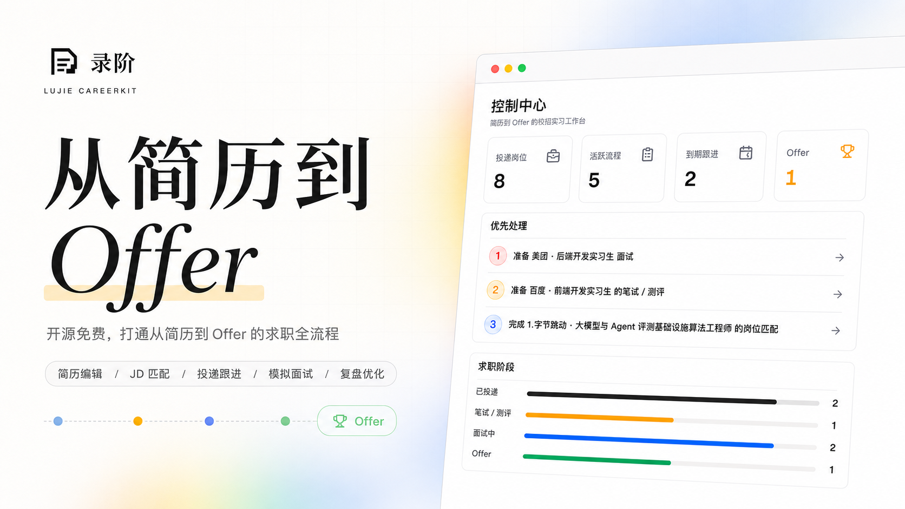
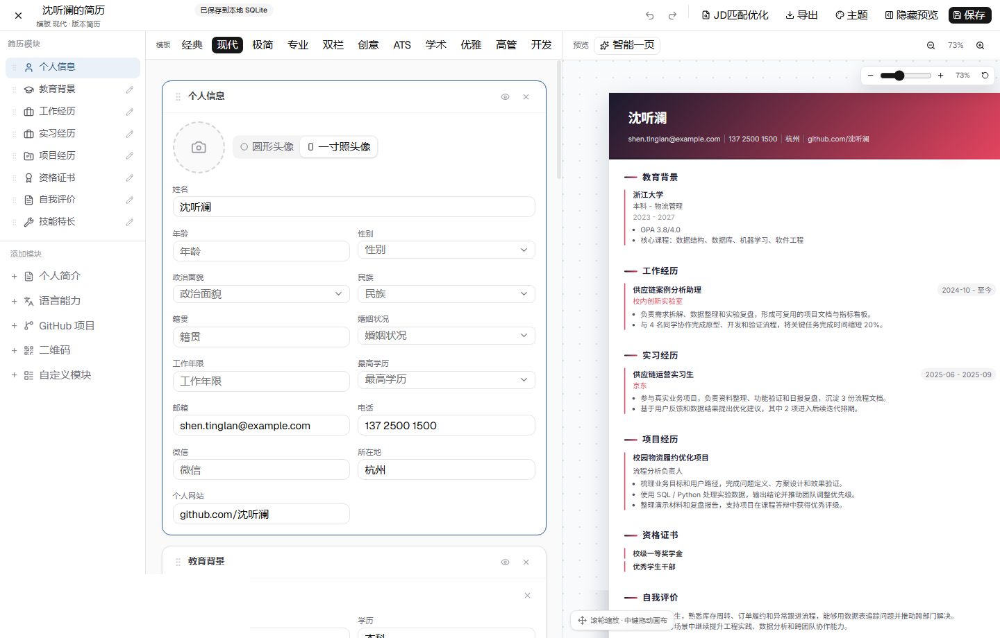
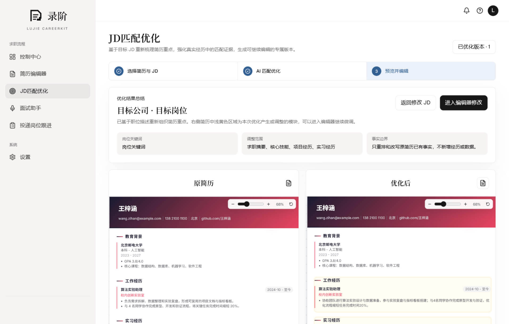
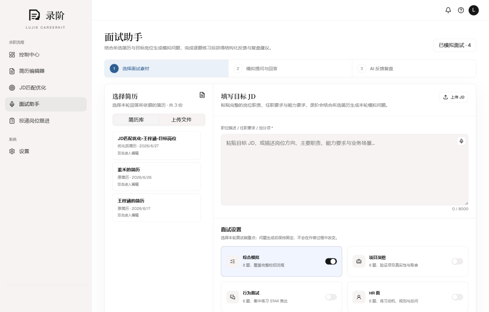
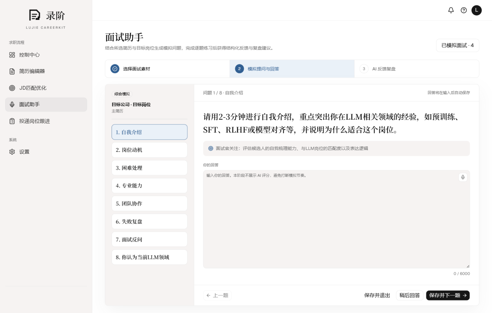
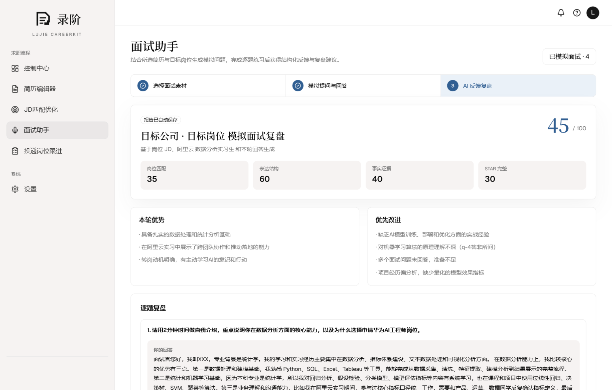
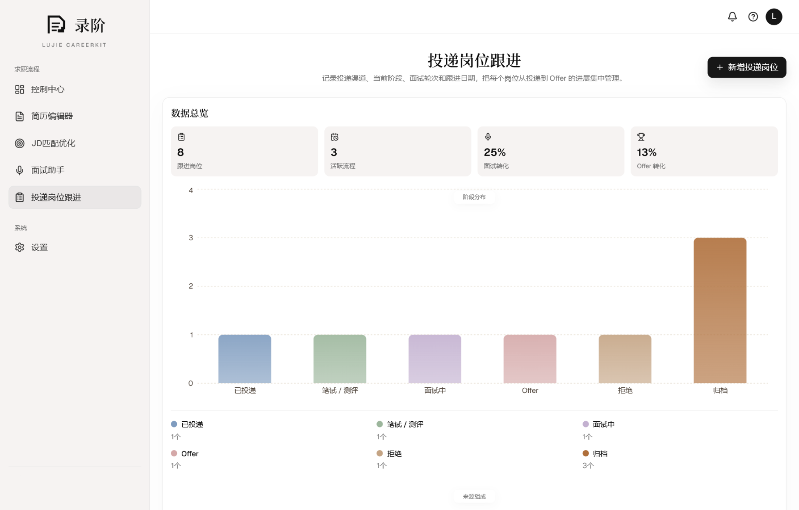
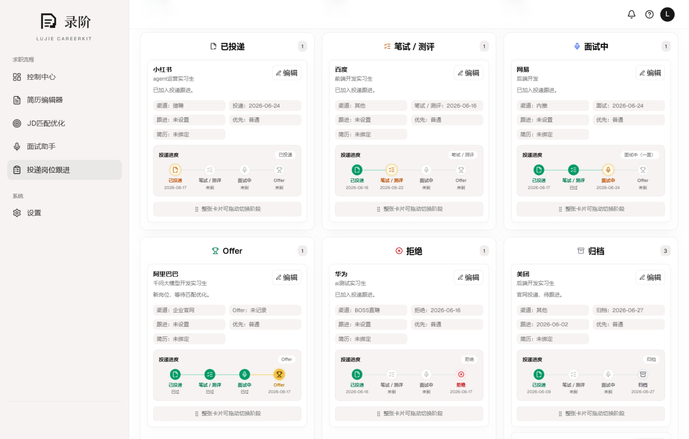

<p align="center">
  
</p>

<h1 align="center">LuJie CareerKit</h1>

<p align="center">
  <strong>A career Agent workspace from resume editing to offer acceptance, covering resume editing, JD matching, application tracking, mock interviews, reviews, and more.</strong>
</p>
<p align="center">
  English · <a href="README.zh-CN.md">简体中文</a>
</p>

<p align="center">
  
  
  
  
  
  
</p>

<p align="center">
  
</p>

## Overview

LuJie CareerKit is built for internships, campus recruiting, and career job searches. It brings resume editing, JD matching, career-material organization, interview preparation, mock practice, and application tracking into an Agent-driven workspace. You can maintain multiple resume versions for different roles, generate more relevant resumes and interview materials from a JD, and continuously organize every analysis, practice session, and application update.

## Online Preview

Try the live preview at [https://lujie.chozzc.dev](https://lujie.chozzc.dev).

## Preview

| **Control Center**                                                 | **Resume Library**                                               |
| ------------------------------------------------------------------ | ---------------------------------------------------------------- |
|           |    |
| **Resume Editor**                                                  | **JD Matching**                                                  |
|                |             |
| **JD-Optimized Resume**                                            | **Interview Assistant**                                          |
|    |  |
| **Mock Interview**                                                 | **AI Review**                                                    |
|              |                      |
| **Application Tracking**                                           | **Pipeline Status**                                              |
|  |          |

## Highlights

- **Structured resume editing**: maintain multiple resume versions, create an independent copy of any resume for experimental edits, edit education, internship, project, skill, and custom sections, switch templates and themes, and export PDF, PNG, or editable DOCX files.
- **AI resume analysis**: diagnose action-result structure, evidence, clarity, and organization first; let the user choose which issues and directions to address; then create an independent optimized version while preserving the original.
- **Cover letters and recruiter greetings**: combine the current resume, a complete JD, and user-provided availability details to generate a formal cover letter or a concise recruiter-chat opener, then edit, copy, or regenerate the result.
- **JD matching**: paste a complete JD with the company, full role title, requirements, and responsibilities, then let AI diagnose evidence, reorder emphasis, improve wording, and save a role-specific version without inventing experience.
- **Role-specific interview prep**: combine a selected resume with a complete JD to generate and save a guide with an overview, capability profile, evidence gaps, core knowledge, experience deep dives, targeted questions, and a preparation plan, then export the complete guide as an editable Word document or print-ready PDF.
- **Application tracking**: record companies, roles, sources, stages, deadlines, follow-up dates, notes, JD text, and linked resume versions.
- **Mock interviews and review**: generate interview questions from a resume and JD, save answer drafts, and create an AI review report you can revisit.
- **Career materials library**: organize original JDs, tailored resumes, interview prep guides, mock answers, and AI reviews by role or material type, with per-artifact viewing, editing, and deletion.
- **Experimental in-app agent**: search applications, read a privacy-filtered resume overview, and create or update application cards only after explicit user confirmation.
- **Job-search Agent Skills**: reuse LuJie's refined workflows for resume improvement, interview preparation, mock interviews, and job application writing in coding agents such as Codex and Claude Code.
- **Data and privacy controls**: resumes, jobs, applications, generated materials, agent conversations, and settings are stored in a local SQLite database for long-term personal use.

## Experimental In-App Agent

v0.3.0 adds a career agent that opens inside the workspace. It uses the model already configured and tested in Settings, so it does not require a second API key. Conversation threads are stored locally as `AgentThread` records in SQLite.

The current experimental version can:

- search existing jobs and application cards from natural-language requests;
- read a privacy-filtered resume overview without sending contact details such as email or phone numbers;
- propose creating or updating an application card, then execute only after explicit confirmation;
- provide contextual guidance about resumes, JDs, interviews, and job-search planning.

It cannot yet directly edit resumes or execute the complete JD optimization and interview-material workflows. It also does not write or delete business data without confirmation. This remains an experimental feature while its tool coverage, context handling, and approval flow continue to evolve.

## Agent Skills

LuJie provides more than an application interface. Four of its refined job-search workflows are also packaged as Agent Skills for coding agents. Each skill includes a complete workflow, research requirements, factual boundaries, and quality checks rather than a single prompt.

| Skill                    | Purpose                                                                              |
| ------------------------ | ------------------------------------------------------------------------------------ |
| `resume-improvement`     | Diagnose and improve a resume, with optional JD-specific tailoring                   |
| `prepare-job-interview`  | Research a company and role, then build a structured interview preparation guide     |
| `mock-interview-coach`   | Run an interactive mock interview with adaptive follow-ups and evidence-based review |
| `job-application-writer` | Write cover letters, recruiter greetings, emails, referrals, and follow-up messages  |

After cloning the repository, launch Codex from the project directory and describe the task directly. Codex can select the relevant skill automatically, or you can explicitly name one such as `$resume-improvement`. Claude Code and other coding agents can also read the corresponding `SKILL.md` and follow the same workflow.

For example:

- `Use $resume-improvement to review this resume for a backend engineering role.`
- `Use $prepare-job-interview with my resume and this JD to build an interview preparation guide.`

For company- or role-specific tasks, the skills proactively research current information when search tools are available and the user has not disabled web access. They require sources, distinguish facts from inference, and prohibit inventing candidate experience, skills, or outcomes.

## Data and Privacy

- Resume content, resume versions, jobs, applications, interview prep guides, mock sessions, agent conversations, and settings are stored in `prisma/dev.db`.
- API keys are configured from the in-app Settings page. They are encrypted before being saved to SQLite.
- `LUJIE_SETTINGS_SECRET` is the local encryption secret for saved AI keys. Use a long random value in `.env.local`.

## Quick Start

### Requirements

- Node.js 20.9 or later
- npm
- Chrome or Edge for the best browser speech experience

### Docker Deployment (Recommended)

```bash
docker run -d --name lujie-careerkit \
  -p 3000:3000 \
  -v lujie-data:/data \
  -e LUJIE_SETTINGS_SECRET="replace-with-a-long-random-string" \
  ghcr.io/chozzc/lujie-careerkit:latest
```

Open [http://localhost:3000](http://localhost:3000). SQLite data is stored in the Docker volume `lujie-data`. API keys are configured from the in-app Settings page.

`LUJIE_SETTINGS_SECRET` encrypts locally saved settings secrets. Replace the example value with a long random string.

Use `latest` to follow the newest `main` build. After v0.3.0 is published, use `v0.3.0` to pin that release.

### Local Development

```bash
git clone https://github.com/Chozzc/Lujie-Careerkit.git
cd Lujie-Careerkit
npm ci
```

Create a local environment file and generate an encryption secret:

```bash
cp .env.example .env.local
node -e "console.log(require('crypto').randomBytes(32).toString('hex'))"
```

On Windows PowerShell:

```powershell
Copy-Item .env.example .env.local
node -e "console.log(require('crypto').randomBytes(32).toString('hex'))"
```

Put the generated value into `.env.local` as `LUJIE_SETTINGS_SECRET`, then start the app:

```bash
npm run dev
```

Open [http://localhost:3000](http://localhost:3000). The app creates the local schema and demo workflow data on first use.

## Environment Variables

```env
DATABASE_URL="file:./dev.db"
LUJIE_SETTINGS_SECRET="change-me-to-a-long-random-string"
OPENAI_BASE_URL="https://dashscope.aliyuncs.com/compatible-mode/v1"
OPENAI_MODEL="qwen3.6-flash"
```

`OPENAI_BASE_URL` and `OPENAI_MODEL` only set first-run defaults. Configure the actual API key from the in-app Settings page.

## AI Provider Setup

1. Open the Settings page in the app.
2. Choose an OpenAI-compatible provider.
3. Enter the Base URL, model name, and API key.
4. Save and run the connection test.

AI features stay disabled until the settings are saved and the connection test succeeds.

## Release Notes

### v0.3.0 (Experimental features in active development)

#### Career materials library and role archives

- Added “By role / By type” browsing with company grouping, search, sorting, and sample-role badges for original JDs, tailored resumes, interview prep, mock answers, and AI reviews.
- Every role now has its own archive page with a structured directory, role overview, preparation path, artifact list, and material-composition summary.
- Original JDs, interview preparation guides, and mock answers can be edited and saved. Role names and artifact titles can be corrected manually, while long titles are safely truncated in the directory.

#### Experimental in-app career agent

- Added a draggable in-app career agent that reuses the OpenAI-compatible model already configured and tested in Settings, with local multi-turn conversation threads.
- The agent can search existing roles and application records from natural language and read resume overviews after email addresses, phone numbers, and other contact details are filtered out.
- It can propose creating or updating an application card, but the user must explicitly confirm the write to prevent natural-language misunderstandings from changing business data directly.
- This remains experimental: it cannot yet directly edit resumes, run complete JD optimization, generate interview materials, delete library content, or automatically complete the full job-search workflow.

#### First-use guidance and sample-data updates

- Added a first-use tour: Dashboard → Connect AI → Meet the experimental agent → Resume editing → JD matching → Interview assistant → Career materials library → Application tracking.
- Added six structured sample roles and one complete Baidu workflow covering a base resume, tailored resume, professional interview preparation, eight complete mock answers, per-question feedback, and an AI review.
- Added “Remove sample data” in Settings. It removes built-in sample roles, the sample resume, and generated sample materials while preserving user-created data and AI settings. “Reset and restore sample data” remains the full local reset action.

### v0.2.5

#### Turn refined job-search workflows into Agent Skills

- Packaged LuJie's refined workflows for resume improvement, interview preparation, mock interviews, and job application writing as four Agent Skills.
- The skills live under `.agents/skills`, where Codex can discover them inside the repository and other coding agents such as Claude Code can read and reuse the same workflows.

### v0.2.4

#### Interview preparation export

- Added an “Export guide” action to generated interview preparation materials, with Word and PDF export options.

#### Review and selectively accept AI resume changes

- AI resume optimization now opens a step-by-step review screen. Changes are grouped by resume section and show the original text beside an editable AI suggestion.
- Each change can be accepted, rejected, or edited independently. The live preview follows the current choices, and only accepted content is saved to a new general-optimization version while the original resume remains unchanged.
- The resume library distinguishes general-optimization versions from JD-optimized versions. GPA, dates, missing facts, and other information that AI should not infer are directed back to the editor for confirmation or completion.

## FAQ

### 1. Do I need an API key to use it?

No. Resume editing, materials browsing, and application tracking work locally. The in-app agent, JD matching, interview prep guides, mock interviews, and AI review require an API key from an OpenAI-compatible provider.

### 2. Where is my data stored?

By default, data is stored on your machine in `prisma/dev.db`. This is local runtime data and should not be committed to GitHub.

### 3. How are Dashboard metrics calculated?

- **Applications**: roles that have entered the application tracking board, excluding JD matching drafts that have not been submitted.
- **Active flows**: roles still in progress, including applied, assessment, and interview stages.
- **Due follow-ups**: active flows only. LuJie first uses the manually set next follow-up date; applied roles without one use seven days after applying as the suggested follow-up date; assessment and interview roles use the current stage date.
- **Offers**: roles marked as Offer.

### 4. What is `LUJIE_SETTINGS_SECRET`?

It is the local encryption secret used to encrypt API keys saved in SQLite. If you change it, API keys already saved in the old database may no longer decrypt, so you may need to save the key again in Settings.

### 5. Can I use another model provider?

Yes. Any OpenAI-compatible provider can be configured by entering its Base URL, model name, and API key in Settings.

## Project Structure

```text
.github/workflows/      GitHub Actions workflows, including GHCR image publishing
Dockerfile              Production container image definition
docker-compose.yml      Local Docker startup with persistent SQLite volume
prisma/                 Prisma schema and local SQLite runtime data
src/app/                Next.js pages and API routes
src/components/         Workspace, resume, interview, and shared UI
src/hooks/              Browser hooks such as speech recognition
src/lib/                Repository, AI, export, parsing, and domain logic
src/stores/             Resume editor state
src/types/              Shared TypeScript declarations
public/brand/           Brand mark and cover assets
public/images/          README screenshots
third-party/            Third-party license notices
```

## Credits

The resume editor reuses and adapts design ideas and implementation concepts from [JadeAI](https://github.com/LingyiChen-AI/JadeAI). JadeAI is licensed under Apache License 2.0; a copy is kept in `third-party/JadeAI-LICENSE.txt`.

## License

LuJie CareerKit is released under the [Apache License 2.0](LICENSE). Third-party notices are listed in [NOTICE](NOTICE).
