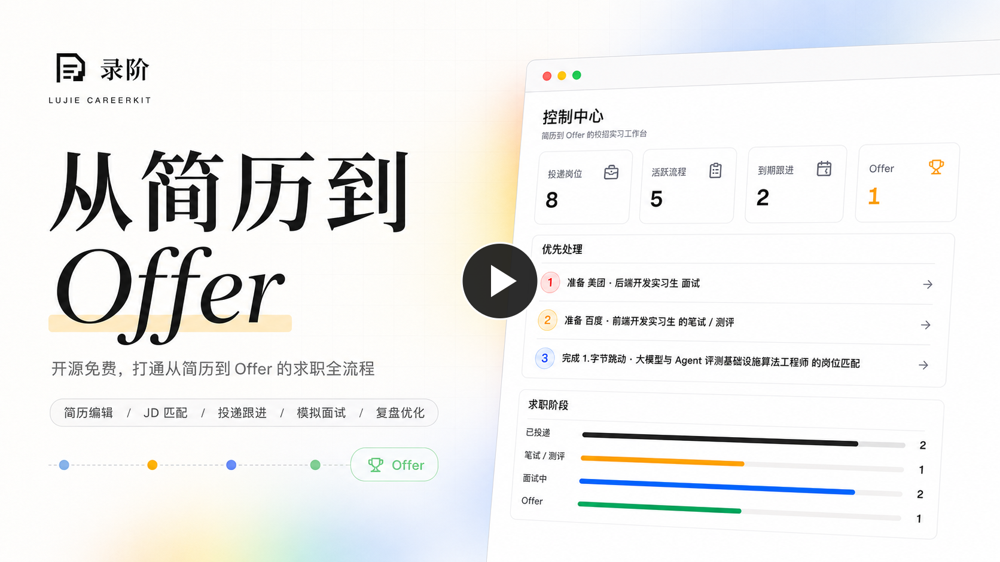

<p align="center">
  
</p>

<h1 align="center">录阶 / LuJie CareerKit</h1>

<p align="center">
  <strong>从简历编辑到 Offer 录用的 求职 Agent 工作台，覆盖简历编辑、JD 匹配、投递跟进、模拟面试和复盘等。</strong>
</p>
<p align="center">
  <a href="README.md">English</a> · 简体中文
</p>
<p align="center">
  
  
  
  
  
  
</p>

<p align="center">
  <a href="public/brand/lujie-promo.zh-CN.mp4">
    
  </a>
</p>

## 项目简介

录阶面向实习、校招和职业求职场景，把简历编辑、岗位匹配、求职资料管理、面试准备、模拟练习和投递跟进放在一个由Agent驱动的工作台里。你可以围绕不同岗位维护多份简历版本，根据岗位描述生成更贴合要求的简历与面试资料，并把每一次分析、练习和投递进展持续沉淀下来。

## 在线预览

访问 [https://lujie.chozzc.dev](https://lujie.chozzc.dev) 体验在线预览。在线预览的个人数据保存在当前浏览器中，不会自动同步到本地源码或 Docker 安装。

## 功能演示

<table width="100%">
  <tr>
    <th width="50%">控制中心</th>
    <th width="50%">录阶Agent· 可自主调用内置求职工具</th>
  </tr>
  <tr>
    <td width="50%" valign="top">
      
    </td>
    <td width="50%" valign="top">
      
    </td>
  </tr>
  <tr>
    <th width="50%">校招信息库</th>
    <th width="50%">简历编辑器</th>
  </tr>
  <tr>
    <td width="50%" valign="top">
      
    </td>
    <td width="50%" valign="top">
      
    </td>
  </tr>
  <tr>
    <th width="50%">JD 匹配优化</th>
    <th width="50%">面试助手</th>
  </tr>
  <tr>
    <td width="50%" valign="top">
      
    </td>
    <td width="50%" valign="top">
      
    </td>
  </tr>
  <tr>
    <th width="50%">求职资料库</th>
    <th width="50%">投递跟进</th>
  </tr>
  <tr>
    <td width="50%" valign="top">
      
    </td>
    <td width="50%" valign="top">
      
    </td>
  </tr>
</table>

## 功能亮点

- **结构化简历编辑**：维护多份简历版本，可从任意简历创建独立副本进行尝试性调整；编辑教育、实习、项目、技能等模块，切换模板和主题，并导出 PDF、PNG 或可编辑 DOCX。
- **AI 分析简历**：先诊断当前简历的行动与结果、事实证据、表达和结构，再由用户选择要处理的问题与优化方向；确认后生成独立优化版本，并保留原简历。
- **求职信与招呼语**：结合当前简历、完整 JD 和用户补充的到岗安排，生成适合正式投递的求职信或重点前置的招聘平台招呼语，并支持编辑、复制与重新生成。
- **JD 匹配优化**：粘贴包含公司、完整岗位名称、要求和职责的目标 JD，让 AI 在不编造经历的前提下诊断匹配点、重排重点、优化表达并保存岗位定制版本。
- **专属面试准备资料**：结合所选简历与完整 JD，生成资料概览、能力画像、证据与差距、核心知识、经历深挖、针对性问题和准备计划，按简历长期保存，并可导出为可编辑 Word 文档或适合打印的 PDF。
- **投递进展管理**：记录公司、岗位、渠道、阶段、截止日期、跟进日期、备注、JD 和绑定简历版本。
- **模拟面试与复盘**：根据简历和 JD 生成面试题，保存逐题回答，并生成可回看、可继续改进的 AI 复盘报告。
- **求职资料库**：按岗位或资料类型整理原始 JD、岗位定制简历、面试准备、模拟问答和 AI 复盘；进入岗位档案即可连续查看、编辑或删除具体成果。
- **校招信息库**：按关键词、招聘类型、毕业届别、地点等条件筛选招聘记录，查看岗位或专业、截止信息与招聘链接；
- **应用内 Agent**：检索校招信息、已有岗位与脱敏简历，打开具体招聘详情，并在用户选择参数、确认写入后创建独立简历、生成 JD 定制简历、面试准备与模拟面试，切换简历模板或维护投递跟进卡片。
- **求职 Agent Skills**：将录阶中已经打磨的简历优化、面试准备、模拟面试和求职沟通流程整理为四个 Skill，让 Codex、Claude Code 等编码智能体也能复用。
- **数据与隐私可控**：简历、岗位、投递、资料库成果、Agent 对话和设置保存在本机 SQLite 数据库里，适合个人长期维护。

## 应用内 Agent

点击右下角小助手打开 Agent，可拖动位置、放大对话、新建会话和回看历史。它复用设置页配置的模型和 API Key；使用前请先完成 AI 配置并测试连接。对话保存在本机 SQLite 中。

使用流程是：**描述需求 → 检索并明确目标 → 选择参数（需要时）→ 核对并确认写入 → 打开成果**。检索不需要审批；创建或更新业务数据时，会展示具体目标和操作内容，你可以确认或取消。JD 定制先选择优化方向，面试准备和模拟面试先选择模式，随后仍需确认写入。

例如：

| 你想做什么 | 示例指令 |
| --- | --- |
| 找校招机会 | 帮我找杭州面向 2027 届的软件相关校招，打开其中一条的详情。 |
| 查投递并设置跟进 | 找到百度的投递记录，把下次跟进设为 2026-10-09，并追加备注“发送跟进邮件”。 |
| 从经历建立简历 | 根据下面这些真实经历创建一份独立简历，目标岗位是后端开发：…… |
| 定制岗位简历 | 用我的后端开发简历匹配这份完整 JD，生成一个新版本：…… |
| 准备面试 | 用百度这个岗位和对应定制简历生成项目深挖面试准备资料。 |
| 开始模拟面试 | 用同一个岗位和简历创建一场综合模拟面试。 |
| 调整简历外观 | 找到我的基础简历，切换为经典模板。 |

示例中的岗位和简历需要存在于你的资料库；目标不明确或缺少完整 JD 时，先补充信息。当前源码提供以下能力：

- 根据自然语言筛选校招信息，分页查看结果、读取完整招聘记录，并从对话打开对应详情；招聘记录不自动加入个人岗位或投递跟进，日期不明也不代表仍可投；
- 根据自然语言检索已有岗位和投递卡片；
- 按名称、岗位、技能、学校、公司或项目检索简历，并按 ID 读取经过隐私过滤的完整内容；
- 草拟新增或更新投递卡片的操作，并在用户明确确认后执行；
- 根据用户口述的真实经历创建新的独立简历；
- 根据完整 JD 创建新的岗位定制简历版本；
- 根据指定岗位和简历生成面试准备资料；
- 让用户选择面试模式后生成模拟面试，并直接进入答题界面；
- 在保留简历事实与分区的前提下切换现有模板；
- 结合当前上下文提供简历、JD、面试和求职规划建议。

当前版本不会覆盖已有简历正文，也不能删除业务数据或操作外部招聘网站；任何业务写入都必须由用户确认。

完整对话历史保存在本机；模型按长度预算读取最近完整轮次，保留未完成的工具和确认过程。历史摘要与跨对话记忆尚未实现，长对话中的早期条件可能需要再次说明。必要内容过长或历史保存发生冲突时会显示提示，请核对已生成的成果后继续。

## Agent Skills

录阶不只提供应用界面，也把其中适合交给编码智能体执行的求职流程整理成了四个 Agent Skill。每个 Skill 都包含完整的执行步骤、调研要求、事实边界和质量检查。

| Skill                    | 用途                                             |
| ------------------------ | ------------------------------------------------ |
| `resume-improvement`     | 诊断并优化简历，也可结合 JD 做岗位定制           |
| `prepare-job-interview`  | 主动调研公司与岗位，生成结构化面试准备资料       |
| `mock-interview-coach`   | 开展逐题模拟面试、动态追问和循证复盘             |
| `job-application-writer` | 撰写求职信、招聘平台招呼语、邮件、内推和跟进消息 |

克隆仓库后，从项目目录启动 Codex，直接描述任务即可；Codex 会根据任务自动选择对应 Skill，也可以用 `$resume-improvement` 等名称明确指定。Claude Code 等其他编码智能体也可以直接读取相应的 `SKILL.md` 来执行同一套流程。

例如：

- `使用 $resume-improvement 分析这份简历，并针对后端开发岗位提出修改建议。`
- `使用 $prepare-job-interview，结合我的简历和这份 JD 生成面试准备资料。`

涉及具体公司或岗位时，Skill 会在搜索工具可用且用户未禁止联网的情况下主动调研，并要求标注来源、区分事实与推断，禁止编造候选人的经历、技能或成果。

## 数据与隐私

- 简历、版本、岗位、投递、面试准备资料、模拟记录、Agent 对话和设置保存在 `prisma/dev.db`。
- Docker 将个人数据保存在挂载的数据卷中；本地源码、Docker 和在线预览之间不会自动同步个人数据。
- API Key 在应用内设置页配置，保存到 SQLite 前会先加密。
- `LUJIE_SETTINGS_SECRET` 是本地加密密钥，用来保护已保存的 AI Key。请在 `.env.local` 里使用足够长的随机字符串。
- AI 任务会将必要的简历、JD 或对话内容发送给所选模型服务；个人数据本地保存不表示 AI 请求完全离线。Agent 读取简历时会过滤邮箱、电话等联系信息。

## 快速开始

### 环境要求

- Node.js 20.9 或更高版本
- npm
- Chrome 或 Edge：浏览器语音识别体验更完整

### Docker 部署（推荐）

```bash
docker run -d --name lujie-careerkit \
  -p 3000:3000 \
  -v lujie-data:/data \
  -e LUJIE_SETTINGS_SECRET="replace-with-a-long-random-string" \
  ghcr.io/chozzc/lujie-careerkit:latest
```

打开 [http://localhost:3000](http://localhost:3000)。SQLite 数据会保存在 Docker volume `lujie-data` 中，API Key 在应用内设置页配置。

`LUJIE_SETTINGS_SECRET` 用于加密本机保存的设置密钥，请替换成一串足够长的随机字符串。

使用 `latest` 会跟随公开 `main` 的镜像构建。需要固定版本时，请从 [GHCR 已发布标签](https://github.com/Chozzc/Lujie-Careerkit/pkgs/container/lujie-careerkit)选择；本地尚未推送的源码功能不会自动出现在镜像中。

### 本地开发

```bash
git clone https://github.com/Chozzc/Lujie-Careerkit.git
cd Lujie-Careerkit
npm ci
```

创建本地环境文件，并生成一个加密密钥：

```bash
cp .env.example .env.local
node -e "console.log(require('crypto').randomBytes(32).toString('hex'))"
```

Windows PowerShell：

```powershell
Copy-Item .env.example .env.local
node -e "console.log(require('crypto').randomBytes(32).toString('hex'))"
```

把生成的值写入 `.env.local` 的 `LUJIE_SETTINGS_SECRET`，然后启动应用：

```bash
npm run dev
```

打开 [http://localhost:3000](http://localhost:3000)。应用会在首次使用时创建本地数据库结构和示例数据。

## 环境变量

```env
DATABASE_URL="file:./dev.db"
LUJIE_SETTINGS_SECRET="change-me-to-a-long-random-string"
OPENAI_BASE_URL="https://dashscope.aliyuncs.com/compatible-mode/v1"
OPENAI_MODEL="qwen3.8-flash"
```

`OPENAI_BASE_URL` 和 `OPENAI_MODEL` 只用于首次默认值。真实 API Key 请在应用内设置页配置。

## AI 服务配置

1. 打开应用内设置页。
2. 选择模型服务商。
3. 填写 Base URL、模型名称和 API Key。
4. 保存后点击测试连接。

保存有效配置后即可使用 AI，建议先测试连接；上次连接测试失败时，需修正配置并重新测试。

## 版本更新

### v0.4.0

新增校招信息库、扩展应用内 Agent 求职工作流，并加强保存和操作确认保护。

#### 校招信息库与机会检索

- 新增搜索、七项独立筛选、排序和招聘详情；源码与 Docker 分发附带招聘数据快照，信息以招聘方官方公告为准。
- Agent 新增校招检索和详情访问，首次引导从八步扩展为九步，加入校招信息库。

#### Agent 工作流与操作保护

- 扩展独立简历创建、JD 定制、面试准备、模拟面试、模板切换和投递跟进；所有业务写入仍需确认，需要时先选择任务参数。
- 模型按预算读取最近完整轮次，保留待完成工具与审批。
- 加强确认和历史保存检查，防止同一次审批重放，并在历史并发更新冲突时提示。

#### 保存、资料管理与导出

- 简历保存改为串行执行，隔离旧编辑会话的迟到结果，切换页面前等待保存；浏览器关闭未保存的编辑页面时提醒。
- 修复资料库无效删除入口，清理示例数据时保留用户自建记录。
- 修复面试资料打印依赖弹窗、简历预览与导出字体差异。

#### 模型配置与运行支持

- 更新模型目录并加入 MiniMax 支持。
- 补齐 Docker 迁移运行依赖与校招数据打包。

#### 功能演示与文档

- 更新双语说明、功能 GIF 和产品演示视频。

### v0.3.0

#### 求职资料库与岗位档案

- 新增“按岗位 / 按分类”两种浏览方式，支持公司分组、搜索、排序和示例岗位标识，集中整理原始 JD、岗位定制简历、面试准备、模拟问答与 AI 复盘。
- 每个岗位都有独立档案页，以目录结构组织资料，并提供岗位概览、准备路径、成果列表和资料构成统计。
- 原始 JD、面试准备和模拟回答可以修改并保存；岗位名称和成果标题可以手动修正，长标题会在目录中安全省略显示。

#### 应用内求职 Agent

- 新增可拖动打开的应用内求职 Agent，复用设置页已经配置并测试成功的 OpenAI-compatible 模型，并将多轮对话保存在本机。
- Agent 可以根据自然语言检索已有岗位和投递记录，并读取过滤邮箱、电话等联系信息后的简历概览。
- Agent 可以草拟新增或更新投递卡片的操作；真正写入前必须由用户明确确认，避免自然语言误解直接改动业务数据。
- v0.3.0 初版尚不支持 JD 定制和面试生成，这些能力见上方 v0.4.0 源码更新；直接覆盖已有简历正文、删除业务数据和自动投递仍不支持。

#### 首次引导与示例数据更新

- 初版提供八步引导：控制中心 → 连接 AI → 认识 Agent → 简历编辑 → JD 匹配 → 面试助手 → 求职资料库 → 投递岗位跟进。
- 内置六个结构化示例岗位，并提供一条完整的百度示例链路：基础简历、岗位定制简历、专业面试准备、八道完整模拟回答、逐题评价与 AI 复盘。
- 设置页新增“一键清空示例数据”，只删除内置示例岗位、示例简历及其生成资料，保留用户自己创建的数据和 AI 设置；“重置并恢复示例数据”仍用于完整重置本地业务数据。

### v0.2.5

#### 将求职流程沉淀为 Agent Skills

- 将录阶中已经打磨的简历优化、面试准备、模拟面试和求职申请写作流程整理为四个 Agent Skill。
- Skill 位于 `.agents/skills`，Codex 可在仓库内直接发现，Claude Code 等其他编码智能体也可读取并复用相同流程。

## 常见问题

### 1. 必须配置 API Key 才能使用吗？

不是。简历编辑、资料库浏览、投递跟进等基础功能可以本地使用；应用内 Agent、JD 匹配、面试准备资料、模拟面试和 AI 复盘等 AI 功能需要配置 OpenAI-compatible 服务的 API Key。

### 2. 我的数据保存在哪里？

源码本地运行默认保存在 `prisma/dev.db`，Docker 保存在挂载的数据卷，在线预览保存在当前浏览器。数据库和对应加密密钥需要一起备份，不应该提交到 GitHub。

### 3. 控制中心的数据怎么计算？

- **投递岗位**：统计已进入投递跟进看板的岗位，不包含还未投递的 JD 匹配草稿。
- **活跃流程**：统计仍在推进中的岗位，包括已投递、笔试 / 测评、面试中。
- **到期跟进**：只统计活跃流程。优先使用手动设置的下次跟进日期；已投递且未设置下次跟进时，按投递后 7 天作为建议跟进日；笔试 / 测评和面试中使用当前阶段日期。
- **Offer**：统计已标记为 Offer 的岗位。

### 4. `LUJIE_SETTINGS_SECRET` 是什么？

它是本地加密密钥，用来加密保存到 SQLite 的 API Key。换掉这个值后，旧数据库里已经保存的 API Key 可能无法解密，需要重新在设置页保存。

### 5. 可以换成别的模型服务吗？

可以。只要服务兼容 OpenAI 接口，就可以在设置页填写对应的 Base URL、模型名称和 API Key。

## 项目结构

```text
.github/workflows/      GitHub Actions workflow，包括 GHCR 镜像发布
Dockerfile              生产容器镜像定义
docker-compose.yml      本地 Docker 启动与 SQLite 持久化卷配置
prisma/                 Prisma schema 与本地 SQLite 运行数据
scripts/                数据迁移脚本
data/campus/            已发布招聘数据快照；本机采集与留档文件忽略
src/app/                Next.js 页面与 API 路由
src/components/         工作台、简历、面试和共享 UI
src/hooks/              浏览器 Hook，例如语音识别
src/lib/                Repository、AI、导出、解析和领域逻辑
src/stores/             简历编辑器状态
src/types/              共享 TypeScript 类型声明
public/brand/           品牌标识和封面资产
public/images/          README 功能 GIF 和截图
third-party/            第三方许可证说明
```

## 致谢

简历编辑器复用并改造了 [JadeAI](https://github.com/LingyiChen-AI/JadeAI) 的部分设计思路和实现概念。JadeAI 使用 Apache License 2.0；对应许可证副本保存在 `third-party/JadeAI-LICENSE.txt`。

## 许可证

录阶使用 [Apache License 2.0](LICENSE) 开源。第三方声明见 [NOTICE](NOTICE)。
